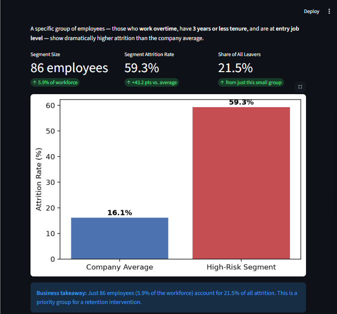

# Employee Attrition & Retention Intelligence


> **AICTE | IBM SkillsBuild Data Analytics with AI Internship 2026**
> Author: Zohra Sayyed Abed Ali 

---

## Project Overview

This project is a complete end-to-end data analytics investigation into **which factors are associated with employees leaving**, built on the IBM HR Analytics Employee Attrition dataset (a fictional dataset, not real employee data). It delivers an interactive, four-tab Streamlit dashboard covering exploratory analysis, compound-risk segmentation, and a logistic regression model — packaged together so that findings can be explored by management without any coding knowledge.

---

## Problem Statement

Employee turnover is one of the most controllable costs a business faces, yet most organisations address it reactively. This project asks:

- **Which factors are most strongly associated with attrition?** (Overtime, tenure, income, job role)
- **Do certain combinations of factors create disproportionate risk?** (Compound-segment analysis)
- **Does a simple, explainable model point to the same factors?** (Logistic Regression)
- **What actions could management investigate?**

---

## Dataset

| Property | Detail |
|---|---|
| **Name** | IBM HR Analytics Employee Attrition & Performance |
| **Source** | [Kaggle — pavansubhasht](https://www.kaggle.com/datasets/pavansubhasht/ibm-hr-analytics-attrition-dataset) |
| **Origin** | Fictional dataset created by IBM data scientists, as stated on its Kaggle page (not real employee data) |
| **Rows** | 1,470 employees |
| **Columns** | 35 original features (4 dropped during cleaning) |
| **Target** | `Attrition` (Yes / No) |

**Preprocessing steps:**
- Dropped four zero-information columns: `EmployeeCount`, `StandardHours`, `Over18`, `EmployeeNumber` (all constant or pure identifiers)
- Created binary target column `Left` (1 = Yes, 0 = No)
- No missing values were present in the source data

---

## Tech Stack

| Layer | Library / Tool |
|---|---|
| Data manipulation | `pandas` (with `numpy` as a dependency) |
| Visualisation | `matplotlib` |
| Machine learning | `scikit-learn` (LogisticRegression, StandardScaler, train_test_split) |
| Dashboard | `streamlit` |
| Language | Python 3 (the dashboard was run with Python 3.14) |

---

## Key Findings

### Overall KPIs
- **1,470** employees analysed; **16.1%** overall attrition rate (**237 leavers**)

### Factors Associated with Attrition
| Factor | Finding |
|---|---|
| **Overtime** | Attrition is 30.5% among employees who work overtime vs 10.4% among those who don't (an association, not proof of cause) |
| **Job Role** | Sales Representatives have the highest observed attrition of any role: **39.8%** |
| **Tenure** | Attrition is highest in the first year (34.9%) and falls across the tenure groups (0–1, 2–3, 4–6, 7–9, 10+ years) to 10.4% for employees with 10 or more years |
| **Income** | Attrition is 29.3% in the lowest income quartile vs 10.3% in the highest (an association; the data do not show why) |

### High-Risk Compound Segment
Employees who simultaneously **work overtime**, have **≤ 3 years tenure**, and are at **entry job level (JobLevel = 1)**:

| Metric | Value |
|---|---|
| Segment size | **86 employees** (5.9% of workforce) |
| Segment attrition rate | **59.3%** (vs 16.1% overall average) |
| Share of *all* leavers | **21.5%** from this one small group |

> This is a priority group for a targeted retention intervention.

### Logistic Regression Model (Supporting Layer)
| Metric | Score |
|---|---|
| Accuracy | **77.7%** |
| Recall | **64.4%** (of actual leavers in the test set correctly identified) |
| Precision | **38.4%** |
| F1 Score | **48.1%** |

Accuracy note: because only about 16% of employees left, a model that predicted "stays" for everyone would score 84.0% accuracy on this test set (368 employees, 59 of whom left), so recall and precision are more informative. The metrics come from a single 75/25 split and are indicative rather than precise.

The model's results are consistent with the factors seen in the exploratory analysis. Its coefficients describe associations in this dataset, not proven causes.

### Proposed Actions for Further Investigation
These are proposed actions for further investigation and evaluation. None has been tested in this project.

1. **Review overtime workload for new, entry-level employees** — a sensible place to start for this group
2. **Review the Sales Representative role** — observed attrition is highest in this role; investigate workload, incentive structure, or role design
3. **Review bottom-quartile pay bands** — attrition is highest in the lowest income quartile in this dataset
4. **Consider a structured first-three-year check-in programme** — observed attrition is highest early in tenure

---

## How to Run

**Prerequisites:** Python 3 installed (the dashboard was run with Python 3.14)

```bash
# 1. Clone / download this repository
# 2. Install dependencies
pip install -r requirements.txt

# 3. Launch the dashboard
streamlit run ZohraSayyed_EmployeeAttritionRetentionIntelligence.py
```

The app will open automatically in your default browser at `http://localhost:8501`.

> The CSV file `WA_Fn-UseC_-HR-Employee-Attrition.csv` must be in the **same directory** as `ZohraSayyed_EmployeeAttritionRetentionIntelligence.py`.

---

## Project Structure

```
project/
├── ZohraSayyed_EmployeeAttritionRetentionIntelligence.py   # All analysis + dashboard code (single file)
├── WA_Fn-UseC_-HR-Employee-Attrition.csv   # Raw dataset (from Kaggle)
├── requirements.txt                        # Python dependencies
├── ZohraSayyed_ProjectReport.docx          # Full project report
└── README.md                               # This file
```

---

## Limitations

1. **Correlation, not causation** — all findings show statistical association; no causal claim can be made without a controlled study or intervention data.
2. **Fictional dataset** — the data is fictional, created by IBM data scientists, and may not reflect any real organisation's dynamics; results should not be generalised without validation on real HR data.
3. **Static snapshot** — the dataset has no timestamps beyond tenure fields; trends over time cannot be tracked.
4. **Class imbalance** — only ~16% of employees left; the model uses `class_weight="balanced"` to compensate, but precision is consequently lower than recall.
5. **Single model** — only Logistic Regression was used (chosen for explainability); a more complex ensemble might predict better but would be harder to interpret in a business context.
6. **No demographic analysis** — age and gender fields exist in the dataset but were not the focus of this investigation; they may warrant a follow-up analysis.
7. **Single train/test split** — the model was evaluated on one 75/25 split (368 test employees, 59 of whom left) and cross-validation was not performed, so the reported metrics are indicative rather than precise.
8. **Segment chosen after exploration** — the high-risk segment combines factors identified during the exploratory analysis of this same dataset, so its attrition rate describes this dataset and may not hold in new data.
